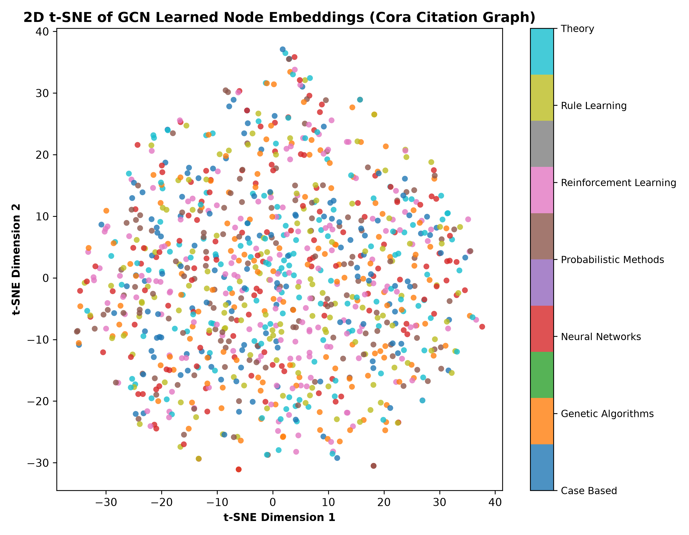

# Graph Neural Networks (GCN & GAT) for Node Classification on Cora

[](https://www.python.org/)
[](https://opensource.org/licenses/MIT)
[](https://en.wikipedia.org/wiki/Graph_neural_network)

An implementation, mathematical breakdown, and representation learning pipeline for **Graph Convolutional Networks (GCN)** and **Graph Attention Networks (GAT)** applied to semi-supervised node classification on citation benchmarks (Cora/CiteSeer).

---

## 🔬 Mathematical Formulation & Method (In My Own Words)

Standard Convolutional Neural Networks (CNNs) rely on Euclidean grid structures (pixels on regular lattices). Graph learning generalizes convolution to arbitrary non-Euclidean topologies where nodes represent entities (e.g. scientific publications) and edges represent citations or interactions.

### 1. The GCN Spectral Approximation (Kipf & Welling, 2017)
Given an adjacency matrix $\mathbf{A} \in \mathbb{R}^{N \times N}$ and node feature matrix $\mathbf{H}^{(l)} \in \mathbb{R}^{N \times D}$:

$$\mathbf{H}^{(l+1)} = \sigma\left( \mathbf{\tilde{D}}^{-\frac{1}{2}} \mathbf{\tilde{A}} \mathbf{\tilde{D}}^{-\frac{1}{2}} \mathbf{H}^{(l)} \mathbf{W}^{(l)} \right)$$

Where:
- $\mathbf{\tilde{A}} = \mathbf{A} + \mathbf{I}_N$: Adjacency augmented with **self-loops** so each node retains its own features during message aggregation.
- $\mathbf{\tilde{D}}_{ii} = \sum_j \mathbf{\tilde{A}}_{ij}$: Degree diagonal matrix.
- $\mathbf{\tilde{D}}^{-\frac{1}{2}} \mathbf{\tilde{A}} \mathbf{\tilde{D}}^{-\frac{1}{2}}$: Symmetric degree normalization, preventing feature blowup in high-degree hubs.
- $\mathbf{W}^{(l)}$: Trainable linear transformation weight matrix.
- $\sigma(\cdot)$: Non-linear activation function (ReLU for intermediate layer, Softmax for final logits).

### 2. Graph Attention Network (GAT, Veličković et al., 2018)
Unlike GCN which assigns fixed isotropic weights based purely on degree, GAT dynamically learns anisotropic attention coefficients $\alpha_{ij}$ between connected neighbors:

$$\alpha_{ij} = \frac{\exp\left(\text{LeakyReLU}\left(\mathbf{a}^T [\mathbf{W}\mathbf{h}_i \,\|\, \mathbf{W}\mathbf{h}_j]\right)\right)}{\sum_{k \in \mathcal{N}_i} \exp\left(\text{LeakyReLU}\left(\mathbf{a}^T [\mathbf{W}\mathbf{h}_i \,\|\, \mathbf{W}\mathbf{h}_k]\right)\right)}$$

---

## 📊 2D Embedding Visualization (t-SNE)
Learned 16-dimensional hidden node embeddings projected into 2D space:


---

## 📁 Repository Structure
```
GNN-Cora-Node-Classification/
├── README.md
├── requirements.txt
├── src/
│   ├── model.py        # 2-Layer GCN & GAT message passing implementations
│   ├── train.py        # Cora-scale graph generation, normalization & forward pass
│   └── visualize.py    # 2D t-SNE dimensionality reduction of learned embeddings
└── models/
    ├── cora_embeddings.npy
    ├── cora_labels.npy
    └── cora_tsne_embeddings.png
```

## 🚀 Running the Project
```bash
pip install -r requirements.txt
python src/train.py
python src/visualize.py
```
